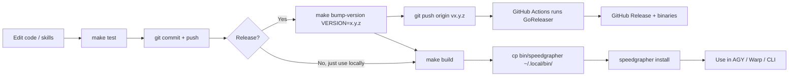
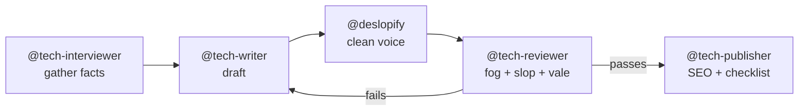

# Speedgrapher: Kai's Operator Guide

A practical, step-by-step guide for **maintaining**, **versioning/building**, **installing**, and **using** Speedgrapher from your fork (`KaiLepler/speedgrapher`) on your Mac.

> [!NOTE]
> Setup this guide assumes (checked on your machine):
> - Repo: `/Users/kai/Developer/GitHub/speedgrapher` → `origin = github.com/KaiLepler/speedgrapher`
> - Go `1.27.x` via Homebrew. `gh` is installed. `goreleaser` is **not** installed.
> - Both `~/.local/bin` and `~/go/bin` are already on your `$PATH`.
> - Latest tag: `v0.10.0`. `main` is 6 commits ahead of it.

---

## 0. How It Fits Together



There are three separate things to keep in mind:

| Thing | What it is | Where it lives |
| :--- | :--- | :--- |
| **Binary** | The `speedgrapher` executable (CLI + MCP server) | `bin/speedgrapher` → copy to `~/.local/bin/` |
| **MCP registration** | An entry telling AGY how to launch the server | `~/.gemini/config/mcp_config.json` |
| **Skills** | The 6 `SKILL.md` personas, **embedded inside the binary** | Unpacked into `~/.gemini/config/skills/` |

> [!IMPORTANT]
> Skills are compiled into the binary (`//go:embed` in [skills.go](file:///Users/kai/Developer/GitHub/speedgrapher/skills/skills.go)). If you edit a `SKILL.md`, you must **rebuild** and then **re-install with `--force`**. Otherwise AGY keeps using the old copy.

---

## 1. Maintaining the Repo

### 1.1 The daily dev loop

```bash
cd ~/Developer/GitHub/speedgrapher

git pull                      # get latest from your fork
# ... edit code ...
make test                     # all packages, verbose
make build                    # -> bin/speedgrapher
./bin/speedgrapher version    # quick sanity check
./bin/speedgrapher check      # verifies Vale / Git / Hugo / Go deps

git add -A && git commit -m "feat: ..." && git push
```

Other useful targets in the [Makefile](file:///Users/kai/Developer/GitHub/speedgrapher/Makefile):

| Command | What it does |
| :--- | :--- |
| `make test-cov` | Tests + `coverage.out` (view: `go tool cover -html=coverage.out`) |
| `make clean` | Deletes `bin/`, `coverage.out`, `dist/` |
| `go mod tidy` | Cleans up dependencies after you add or remove imports |

Dependabot ([.github/dependabot.yml](file:///Users/kai/Developer/GitHub/speedgrapher/.github/dependabot.yml)) opens PRs for dependency bumps. Merge them after CI and `make test` pass.

### 1.2 Pulling changes from upstream (danicat)

Your fork only has `origin` right now. To get Dani's upstream changes, add it once:

```bash
git remote add upstream https://github.com/danicat/speedgrapher.git
```

Then, whenever you want to sync:

```bash
git fetch upstream --tags
git checkout main
git merge upstream/main        # or: git rebase upstream/main
make test
git push origin main
git push origin --tags         # optional: mirror upstream tags into your fork
```

### 1.3 Editing skills

```bash
# 1. Edit e.g. skills/deslopify/SKILL.md
# 2. Rebuild so the new text gets embedded
make build
cp bin/speedgrapher ~/.local/bin/
# 3. Overwrite the unpacked copies AGY reads
speedgrapher install --skills --force
```

---

## 2. Versioning & Tags (the part that's confusing)

### 2.1 The rule: the Git tag *is* the version

No file in the source code holds the version number (see [ADR-0005](file:///Users/kai/Developer/GitHub/speedgrapher/design/adr/0005-source-of-truth-for-versions-is-git-tags.md)). The version is injected **at build time**:

```makefile
VERSION ?= $(shell git describe --tags --always --dirty | sed 's/^v//')
LDFLAGS  = -ldflags "-s -w -X main.version=$(VERSION)"
```

`git describe` looks at the nearest tag and describes your current commit relative to it:

| Repo state | `git describe` | `speedgrapher version` prints |
| :--- | :--- | :--- |
| HEAD is exactly on tag `v0.10.0` | `v0.10.0` | `0.10.0` |
| 6 commits after `v0.10.0` (**your state now**) | `v0.10.0-6-ga2cbf9c` | `0.10.0-6-ga2cbf9c` |
| Same, plus uncommitted changes | `v0.10.0-6-ga2cbf9c-dirty` | `0.10.0-6-ga2cbf9c-dirty` |
| No tags at all | `a2cbf9c` | `a2cbf9c` |

So the order matters: **commit → tag → build**. If you build before tagging, the binary gets the "commits after the old tag" version.

### 2.2 What you set, and where

| What | Where you set it | Notes |
| :--- | :--- | :--- |
| Release version | **Command line only**: `make bump-version VERSION=0.11.0` | Must be passed explicitly; the target refuses otherwise |
| Tag format | Automatic: `v` + VERSION (e.g. `v0.11.0`) | The `v` prefix is **required**. The release workflow only triggers on `v*` tags |
| One-off local version | `make build VERSION=0.11.0-test` | Stamps the binary **without** creating a tag. Good for experiments |
| `GITHUB_TOKEN` (CI) | Nothing to do: GitHub provides it automatically | The workflow already declares `permissions: contents: write` |
| Actions on your fork | GitHub → your repo → **Settings → Actions → General** | Forks often have Actions **disabled** by default. Enable them once |

Pick the next number using semver:
- **Patch** `0.10.0 → 0.10.1`: bug fixes, doc fixes, skill text tweaks
- **Minor** `0.10.0 → 0.11.0`: new tool, new skill, new CLI flag
- **Major** `0.x → 1.0.0`: breaking CLI/MCP changes (or when you decide it's "stable")

### 2.3 Fixing a tag mistake (before pushing)

```bash
git tag -d v0.11.0                    # delete local tag
make bump-version VERSION=0.11.0      # re-create on the right commit
```

If you already pushed it: `git push origin :refs/tags/v0.11.0`, then delete the GitHub Release in the web UI and re-tag. Avoid this if anyone has already installed that version.

---

## 3. Building

### 3.1 Local build (what you'll do 95% of the time)

```bash
make build                     # version from git describe
./bin/speedgrapher version
```

The output is a single static binary at `bin/speedgrapher` (git-ignored).

### 3.2 Cross-platform release build (optional, local dry run)

GoReleaser builds for macOS, Linux, and Windows using [.goreleaser.yaml](file:///Users/kai/Developer/GitHub/speedgrapher/.goreleaser.yaml). To test the packaging locally without publishing:

```bash
brew install goreleaser        # one-time
make snapshot                  # -> dist/ with all archives, nothing uploaded
ls dist/
```

Archive names look like `darwin.arm64.speedgrapher.tar.gz`. [install.sh](file:///Users/kai/Developer/GitHub/speedgrapher/install.sh) depends on this exact naming, so don't change `name_template` without also updating `install.sh`.

---

## 4. Releasing (Publishing to GitHub)

### 4.1 The recommended flow: let GitHub Actions do it

```bash
# 0. Clean tree on main, everything pushed
git status                               # must be clean
git pull

# 1. Verify
make test

# 2. Tag the release commit (annotated tag v0.11.0)
make bump-version VERSION=0.11.0

# 3. (Optional) build + check the stamp locally
make build && ./bin/speedgrapher version   # -> 0.11.0

# 4. Push the tag: this triggers the release
git push origin v0.11.0
```

Pushing the tag triggers [release.yml](file:///Users/kai/Developer/GitHub/speedgrapher/.github/workflows/release.yml), which runs GoReleaser and creates a GitHub Release with binaries and an auto-generated changelog. Watch it with:

```bash
gh run watch                 # live CI progress
gh release view v0.11.0      # check the published release
```

> [!WARNING]
> **Don't also run `make release` locally** after pushing the tag (the main README lists it as step 6). CI already publishes the release, so running it locally would try to publish a second time and fail or collide. Only use `make release` if you have no CI. It needs `goreleaser` installed and `export GITHUB_TOKEN=$(gh auth token)`.

### 4.2 Fork-specific gotchas

> [!CAUTION]
> These are about your fork vs. Dani's upstream. Worth fixing before your first release.

1. **CI Go version mismatch**: `release.yml` pins `go-version: '1.24'`, but `go.mod` requires `go 1.27.1`. Go's toolchain auto-download may cover the gap, but the clean fix is to replace that line with:
   ```yaml
   with:
     go-version-file: go.mod
   ```
2. **`install.sh` downloads from upstream**: it has `REPO="danicat/speedgrapher"`. If you want the curl one-liner to install **your** releases, change it to `REPO="KaiLepler/speedgrapher"`.
3. **Module path is still `github.com/danicat/speedgrapher`**: so `go install github.com/danicat/...@latest` installs **Dani's** version, not yours. `go install github.com/KaiLepler/...` will fail because of the path mismatch. For your fork, install from the local clone (section 5). Only rename the module path if you plan to diverge permanently, since it makes merging upstream harder.

---

## 5. Installing Locally

### 5.1 Recommended: build from your clone

```bash
cd ~/Developer/GitHub/speedgrapher
make build
cp bin/speedgrapher ~/.local/bin/          # on your PATH, keeps the version stamp
speedgrapher version                       # verify it resolves from anywhere
speedgrapher install                       # register MCP + unpack skills (global)
```

Why `cp` instead of `go install ./cmd/speedgrapher`? `go install` skips the Makefile's `-ldflags`, so the version shows up as a commit hash instead of `0.11.0`. Both work. `cp` just gives you nicer version output.

### 5.2 What `speedgrapher install` changes

| Change | Location |
| :--- | :--- |
| Adds a `"speedgrapher"` entry under `mcpServers` | `~/.gemini/config/mcp_config.json` |
| Unpacks the 6 skills | `~/.gemini/config/skills/<skill>/SKILL.md` |

Because the binary is on your `PATH`, the config gets `"command": "speedgrapher"` instead of an absolute path. That means **future upgrades only need a new `cp`**, and the config never needs touching (except `--force` for skill changes).

Useful flags:

```bash
speedgrapher install --mcp           # MCP registration only
speedgrapher install --skills        # skills only
speedgrapher install --force         # overwrite existing skill files
speedgrapher install -w              # workspace scope: ./.agents/ in current dir
GEMINI_CONFIG_DIR=/some/dir speedgrapher install   # alternative global root
```

### 5.3 Upgrading after changes

```bash
git pull && make test && make build
cp bin/speedgrapher ~/.local/bin/
speedgrapher install --skills --force    # only if skills changed
```

Then **reload MCP servers in AGY** (or restart it) so it launches the new binary.

### 5.4 Uninstalling

```bash
speedgrapher uninstall          # removes MCP entry + skills from ~/.gemini/config
speedgrapher uninstall -w       # same for ./.agents/ in current workspace
rm ~/.local/bin/speedgrapher
```

---

## 6. Applying & Using It

### 6.1 In Antigravity (main use case)

After a global install, Speedgrapher is available in **every** AGY workspace. Nothing needs to be added to other repos. Just ask in chat:

| Goal | Example prompt |
| :--- | :--- |
| Detect AI slop | *"Run the slop tool on `drafts/post.md` and list the worst sentences."* |
| Readability | *"What's the Fog index of the intro in `README.md`? Aim for under 13."* |
| Style lint | *"Run vale on `docs/guide.md` and fix the errors."* |
| SEO audit | *"Run analyze_seo on `content/posts/mcp.md` with keyword `mcp`."* |
| Persona: rewrite | *"Use @deslopify to rewrite `intro.md` so it sounds human."* |
| Persona: full pipeline | *"@tech-interviewer → interview me about X, then @tech-writer drafts, @tech-reviewer gates it, @tech-publisher preps it."* |

Suggested writing pipeline for a blog post:



### 6.2 Per-project setup (optional)

Inside a blog/docs repo, if you want project-specific settings:

```bash
cd ~/path/to/blog
speedgrapher init        # creates speedgrapher.json + .agents/ workspace skills
```

Add domain terms to `speedgrapher.json` so Vale stops flagging them:

```json
{
  "accept": ["Speedgrapher", "MCP", "Antigravity", "agentic"]
}
```

A project-level `.vale.ini` takes priority over the bundled Vale rules.

### 6.3 From the terminal / Warp (no agent needed)

```bash
speedgrapher list                                   # available tools
cat draft.md | speedgrapher call slop               # pipe a file
cat draft.md | speedgrapher call fog
speedgrapher call vale '{"path": "draft.md"}'
speedgrapher call seo  '{"path": "index.html", "keyword": "mcp"}'
```

For Warp's AI agent, add an MCP server with command `speedgrapher`, args `["mcp"]`. See [README-how-to-workflow.md](file:///Users/kai/Developer/GitHub/speedgrapher/README-how-to-workflow.md) for details.

### 6.4 As an HTTP service (rarely needed)

```bash
speedgrapher mcp --listen=127.0.0.1:8080
```

Point HTTP-capable MCP clients at `http://localhost:8080`.

---

## 7. Troubleshooting

| Symptom | Fix |
| :--- | :--- |
| `speedgrapher: command not found` | `cp bin/speedgrapher ~/.local/bin/` (or `which -a speedgrapher` to check) |
| Version shows `...-dirty` | You built with uncommitted changes. Commit first, then rebuild |
| Version shows `0.10.0-6-g…` after tagging | You built **before** tagging. Run `make build` again |
| AGY doesn't see the tools | Check `~/.gemini/config/mcp_config.json` has the entry. Reload MCP servers / restart AGY |
| Skill edits don't show up in AGY | Rebuild → `cp` → `speedgrapher install --skills --force` |
| Release workflow didn't run | Tag must start with `v`. Actions must be enabled on the fork. Check with `gh run list` |
| GoReleaser: "git is in a dirty state" | Commit or stash everything; the tag must point at a clean HEAD |
| Vale errors on first run | `speedgrapher check`. Vale gets auto-downloaded on first use (needs network) |

---

## 8. Cheat Sheet

```bash
# Dev loop
make test && make build && ./bin/speedgrapher version

# Use my latest local code everywhere
make build && cp bin/speedgrapher ~/.local/bin/ && speedgrapher install --skills --force

# Release v0.11.0
git status && make test
make bump-version VERSION=0.11.0
git push origin v0.11.0 && gh run watch

# Sync from upstream
git fetch upstream --tags && git merge upstream/main && make test && git push
```
